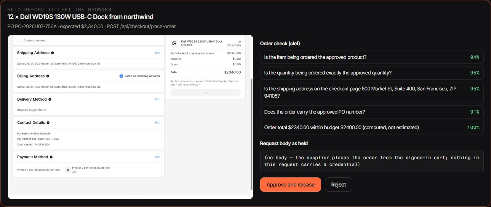
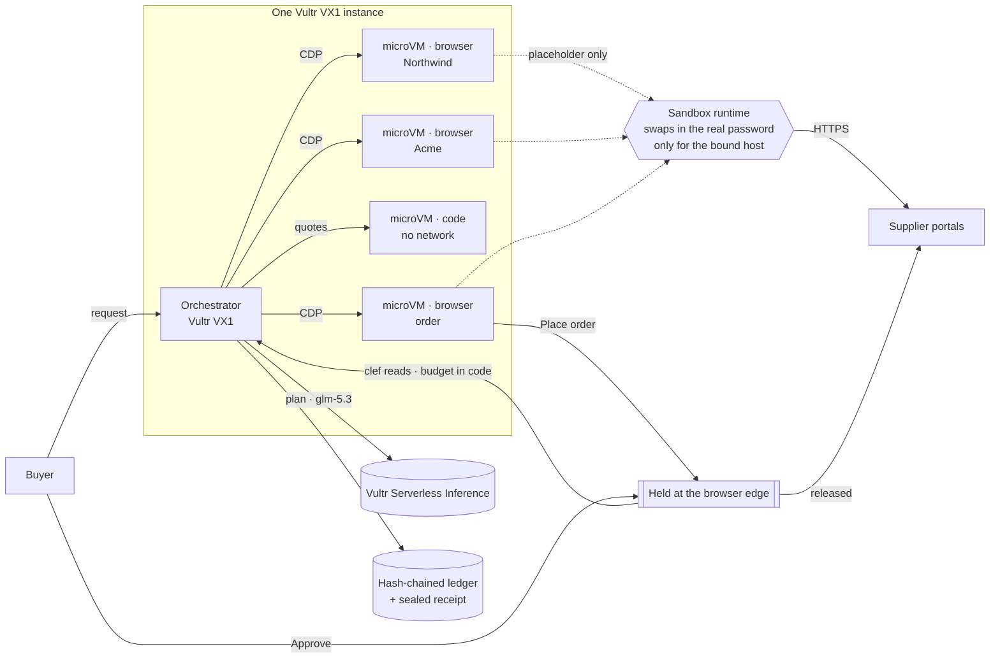
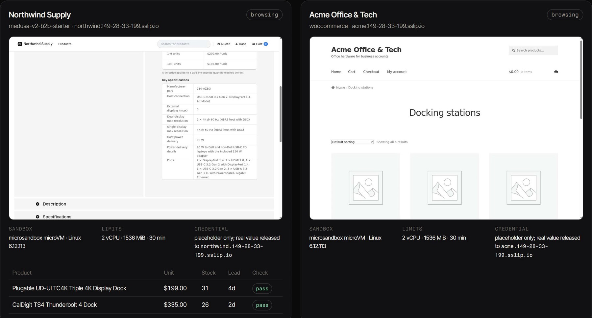
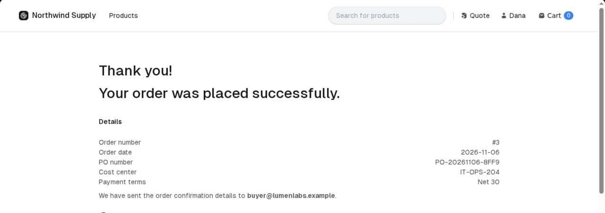
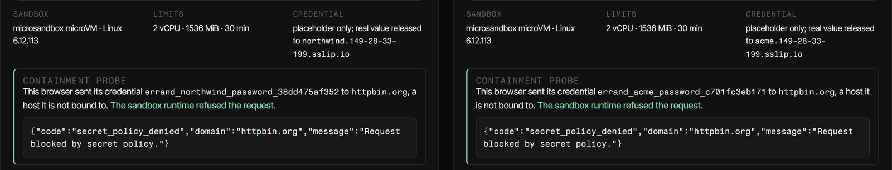

# Errand

**Your agent works signed in. It never sees the password.**

[](https://github.com/RaYYeR220/errand/actions/workflows/ci.yml)

Errand is a purchasing agent for a company's buyers. It signs in to your supplier portals, compares contract prices, stock, lead time and shipping, fills the purchase order, and places it after you approve. Every browser it uses runs in its own microVM on Vultr, holds only a placeholder for the password, and is destroyed when its task ends. The order request itself is held before it leaves the browser until it has been checked and released by a person.

- **Live:** https://errand.207-246-93-94.sslip.io — press *Run an errand*; you are the reviewer who approves the order.
- **Demo video (3 min):** https://youtu.be/9DKPpHRY748
- **Supplier portals it works against:** [Northwind Supply](https://northwind.149-28-33-199.sslip.io/us) (Medusa B2B) · [Acme Office & Tech](https://acme.149-28-33-199.sslip.io) (WooCommerce)
- **Review in five minutes:** [JUDGES.md](JUDGES.md) · **Every claim and its evidence:** [CLAIMS.md](CLAIMS.md)


<sub>A live errand on Vultr: *Place order* held before it left the browser. `clef` read the checkout against the approved intent; the budget was computed in code; the reviewer decides.</sub>

<!-- containment:start -->
| Same browser, same microVM | Real password reached a host it is not bound to | Refused outright by the sandbox runtime | Sign-in to the bound host still works |
|---|---|---|---|
| Browser holds the real password (the usual way) | **15 / 15** | 0 / 15 | 3 / 3 |
| **Errand** (placeholder + destination-bound secret) | **0 / 15** | 9 / 15 | 3 / 3 |

<sub>5 ways of sending a credential to an unbound host × 3 seeds, on Linux 6.12.113 microVMs on a Vultr VX1 instance. Public echo services report what actually arrived. Source: [`eval/results/containment.json`](eval/results/containment.json), produced by [`eval/containment.ts`](eval/containment.ts).</sub>
<!-- containment:end -->

---

## The errand

A buyer at Lumen Labs needs **12 USB-C docks that drive two 4K monitors and deliver at least 90 W, for $2,400 delivered, within 3 business days.** The company buys from two suppliers, each with its own portal, its own business login and its own contract prices that only show up after signing in.

The obvious shortcuts all pick the wrong dock ([reference scenario](suppliers/EXPECTED.md)):

- the lowest contract price (Anker 563 at Acme, $129) cannot drive two 4K displays;
- the cheapest dock that meets the specs (Plugable at Acme, $2,298 delivered) takes 6 business days;
- Acme's Dell WD19S looks cheaper than Northwind's until shipping is added: $2,418, over budget;
- without the 10+ volume tier, Northwind's Dell looks like $2,508 and out of budget.

The only answer that meets every constraint is **Northwind Supply, Dell WD19S 130W, 12 × $195.00 = $2,340.00, free shipping, 2 business days.** Errand's first live run on Vultr reached exactly that and placed the order after review.

## How it works



1. **Plan.** `glm-5.3` turns the request into hard requirements. Anything that moves money or goods (quantity, budget, deadline, ship-to) comes from the validated request, never from the model's reading of it; ship-to must be in the company's address book.
2. **Sign in and read.** One microVM per supplier, in parallel. Inside each, Chromium is driven over CDP by `glm-5.3-flash`, which sees the page's accessibility tree and a screenshot. The password exists in the VM only as a token like `errand_northwind_password_78347a11e96e`; the agent types the token. The Microsandbox runtime substitutes the real value outside the guest, and only on requests to the host the secret is bound to. Sent anywhere else, the request is refused with `secret_policy_denied`.

   
3. **Check every offer.** Each recorded offer is checked against its own screenshot and page text by `clef`, Vultr's decisions model, which returns a calibrated probability per question (product, price tier, stock, lead time). `nemotron-3.5-content-safety` flags page text that is aimed at the agent; the flag is written to the ledger as a signal, the guarantee never depends on it.
4. **Compute in a sealed room.** `glm-5.3` writes the landed-cost script. It runs in a second microVM with no network at all; errors go back to the model; the control plane recomputes the answer and only proceeds when both agree.
5. **Hold the order.** A fresh microVM signs in again and fills the cart and purchase order. When it clicks *Place order*, the request is paused at the browser's network layer by the control plane (CDP request interception), outside the model's reach. `clef` reads the checkout and the held request against the approved intent; the total is compared with the budget **in code**. A failing check rejects the held request automatically and tells the agent which check failed; it gets one chance to correct the checkout, and a second failure ends the order. Otherwise a person approves or rejects it, and a person's rejection always ends it. Any other order-like request to the supplier during checkout is held too.
6. **Seal.** Every microVM is destroyed. Every step is an entry in a hash-chained ledger (`sha256(prev ‖ canonical(entry))`); the run ends with a sealed receipt.

   

## What the sandbox absorbs

Every run proves the credential boundary on screen: after its work, each supplier browser sends its credential to `httpbin.org`, a host it is not bound to, and the sandbox runtime refuses the request.



The challenge asks for four kinds of containment. Here is where each one lives.

| | How Errand does it |
|---|---|
| **Process isolation** | Every browser and every piece of model-written code runs in a Microsandbox microVM with its own kernel (libkrun over KVM on VX1). Nothing the agent touches runs on the host or inside the app runtime. |
| **Secret hygiene** | No API key enters a sandbox; the inference key lives in the control plane. Supplier passwords enter only as placeholders bound to one host each; the real value is added by the runtime outside the guest. The landed-cost microVM has no network at all. |
| **Resource limits** | Each microVM has fixed vCPU, memory and a maximum lifetime; each command in the code microVM has a timeout. |
| **Lifecycle discipline** | Each microVM is destroyed when its task ends; the order is placed from a fresh one. |

## Built on Vultr

| | |
|---|---|
| **VX1 Cloud Compute** | Hosts the web app, the orchestrator and every microVM (VX1 exposes nested virtualization, so microVMs get KVM). |
| **Vultr Serverless Inference** | `glm-5.3` (planning, code), `glm-5.3-flash` (browser operator, vision), `clef` via `/v1/systemone` (calibrated checks), `nemotron-3.5-content-safety` (page screening). Every response's `model` field is checked against the requested model. |
| **Cloud Compute** | A second instance runs the supplier network on real open-source commerce software. |
| **Vultr API** | `infra/provision.ts` creates both instances, the firewall group and the SSH key binding. |

## Run it

**Locally** (Windows, macOS or Linux with a hypervisor; Microsandbox runs on KVM, Windows Hypervisor Platform or Apple Silicon):

```bash
pnpm install && pnpm -r build
cd suppliers && scripts/init-env.sh && docker compose up -d --build && scripts/seed.sh && cd ..
cd services/orchestrator && INFERENCE_API_KEY=... SUPPLIERS_FILE=../../suppliers/suppliers.json BASE_DOMAIN=... npx tsx src/server.ts
cd apps/web && npx next dev -p 3317
```

**On Vultr:** `npx tsx infra/provision.ts --region ewr`, then `infra/deploy-suppliers.sh <supplier-ip>` and `infra/deploy-control.sh <control-ip> <supplier-ip>`.

| Variable | Where | Purpose |
|---|---|---|
| `INFERENCE_API_KEY` | orchestrator | Vultr Serverless Inference key |
| `SUPPLIERS_FILE`, `BASE_DOMAIN` | orchestrator | supplier definitions and their domain |
| `NORTHWIND_BUYER_PASSWORD`, `ACME_BUYER_PASSWORD` (+ `…BUYER2…`, `…BUYER3…`) | orchestrator | the buyer accounts, one per person on the team (never sent to a sandbox) |
| `MAX_CONCURRENT_RUNS`, `MAX_QUEUED`, `PER_CLIENT_PER_HOUR` | orchestrator | errands side by side (also capped by buyer accounts per supplier), queue length, and the public demo's per-visitor limit |
| `RUN_TOKEN` | orchestrator | when set, creating an errand requires it (company mode); the public demo leaves it unset |
| `COMPANY_ADDRESSES` | orchestrator | the address book ship-to must come from |
| `MCP_TOKEN` | orchestrator | enables the MCP endpoint |

**Tests:** `pnpm -r test` (30 unit tests: ledger chain, landed-cost reference, hold matching, checkout total parsing, address fields). **Containment eval:** `cd services/orchestrator && SEEDS=3 npx tsx ../../eval/containment.ts`.

## MCP

`POST /mcp` (Streamable HTTP, bearer `MCP_TOKEN`) exposes `list_suppliers`, `run_errand` and `get_errand`, so another agent can send Errand on an errand and follow it. There is deliberately no approve tool: `run_errand` returns a review link for a person.

## Honest limits

- **Session cookies live in the browser.** The password never enters the microVM, but once signed in the session cookie does, scoped to the supplier's domain. The VM is destroyed after its task.
- **The order hold covers what the browser sends.** It is enforced over CDP from the control plane; a process inside the VM that bypassed Chromium would not be held. Only Chromium runs there, and it never has the password.
- **The decisions model does not do arithmetic.** Asked whether 12 × $195 is within $2,400 it answered 0.10, so money is checked in code and `clef` only answers what needs reading the page.
- **Two of the five eval cases have no readable answer** when Errand's runtime refuses them (the refusal carries no CORS headers, so the page script cannot read it). They count only as "the real value did not arrive".
- **The suppliers are a demo network**, two fictional companies on real open-source stacks (Medusa 2.8 B2B starter, WooCommerce 11), not real distributors. Payment is "pay on account"; no money moves.
- **Not measured yet:** how often page text steers the agent off task. The guarantees above hold either way.
- Medusa's B2B "accept quote" flow can also create an order; it requires the merchant to act first and is not covered by the hold rules.

## License

MIT
